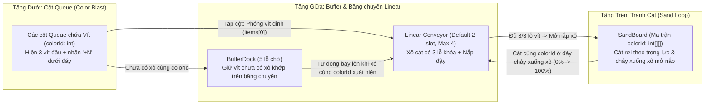

# 01. PHÂN TÍCH BẢN GỐC & THIẾT KẾ CƠ CHẾ GAMEPLAY (GDD)

> **Điều hướng nhanh:** [00_INDEX](./PLAN_SAND_CONVEYOR.md) | **01_MECHANICS** | [02_ARCHITECTURE](./02_TECH_ARCHITECTURE_FOLDER.md) | [03_ASSETS](./03_ASSET_SPEC_INVENTORY.md) | [04_SCHEMA_CONFIG](./04_DATA_SCHEMA_CONFIG.md) | [05_LEVEL_DATA](./05_LEVEL_DATA_PACK.md) | [06_ROADMAP_QA](./06_ROADMAP_QA_RISKS.md)

---

## 1. Tóm tắt Game & Core Loop

- **Thể loại:** Hybrid Casual Puzzle kết hợp 3 cơ chế:
  1. **Sand Loop** (Khung tranh cát chảy theo trọng lực + Băng chuyền Linear).
  2. **Screw Jam** (Xô cát khóa bởi **3 lỗ đinh vít** + Khay chờ tạm 5 lỗ).
  3. **Color Blast** (Các cột hàng đợi Queue thẳng đứng bắn phần tử ở đỉnh).
- **Mục tiêu:** Tháo các đinh vít mang mã màu (`colorId: int`) từ các cột Queue bên dưới để lấp đầy **3 lỗ khóa** trên các xô đựng cát đang chạy trên băng chuyền Linear. Khi đủ 3 vít cùng `colorId`, xô cát bật mở nắp và hút hạt cát cùng `colorId` từ đáy bức tranh phía trên chảy xuống cho tới khi tranh sạch 100%.

---

## 2. Chi tiết Cơ chế 3 Tầng (Mechanics & Rules)

### 2.1. Tầng Trên — Khung Tranh Cát (`SandBoard` / `DrawableChunk`)
- **Dữ liệu lưới:** Biểu diễn bằng mảng 2 chiều số nguyên `grid: number[][]` kích thước `width × height` (trong đó `0` là ô trống, `1..N` là `colorId` tra cứu từ `palette.json`).
- **Chia hạt mịn (`subDivision`):** Mỗi ô logic trên `grid` được chia thành `subDivision × subDivision` hạt cát hiển thị (mặc định `subDivision = 4` $\rightarrow$ mỗi ô gồm $4 \times 4 = 16$ hạt tròn nhỏ, giống `SizeDelta = 4` trong `DrawableChunk.cs` của `SandLoopGame`).
- **Quy tắc chảy & Trọng lực:**
  - Cát chỉ được rút từ **hàng thấp nhất còn cát (`lowestRow(x)`)** của mỗi cột $x$.
  - Khi 1 ô/hạt cát ở đáy cột $x$ chảy xuống xô trên băng chuyền, toàn bộ các ô cát phía trên nó trong cùng cột $x$ (`0 .. y-1`) lập tức rơi thẳng xuống 1 bậc theo trọng lực (`gravity = 2200 px/s²`).

### 2.2. Tầng Giữa — Băng chuyền Tuyến tính (`LinearConveyor`), Xô 3 Lỗ (`SandBucket`) & `BufferDock`
- **Băng chuyền Linear (`isLinear = true`):**
  - Chạy ngang một chiều từ **Hầm Trái (`startTunnel`)** sang **Hầm Phải (`endTunnel`)**, tốc độ chuẩn `beltSpeedPxPerSec = 42`.
  - Nếu người chơi nhấn giữ màn hình (`hold >= 125ms`), tốc độ băng chuyền tăng lên `1.75x` (tham chiếu `ConveyorLinear.cs`).
- **Số lượng Slot trên Băng chuyền (Điều chỉnh qua Config):**
  - Mặc định khi vào màn: **`defaultActiveSlots = 2`** (chỉ có 2 xô cát tối đa cùng lúc trên băng chuyền).
  - Tối đa cho phép mở: **`maxActiveSlots = 4`**.
  - Để mở từ `2` $\rightarrow$ `3` $\rightarrow$ `4` slot, người chơi sử dụng **Booster 1 (`ExtraSlot` - nút `+`)**.
- **Cơ chế Xô Đựng Cát 3 Lỗ Khóa (`SandBucket`):**
  1. **Xuất hiện (`SPAWNING`):** Khi 1 trong các slot đang hoạt động (`slotIndex < activeSlots`) bị trống và đi qua hầm trái, xô tiếp theo trong `bucketQueue` được đặt lên slot đó.
  2. **Đóng nắp (`LOCKED`):**
     - Mỗi xô mang 1 `colorId: int`, sức chứa `capacity: int`, nắp đang đóng kín và thân xô có **3 lỗ cắm vít (`holes: [null, null, null]`)**.
     - Khi chưa lấp đủ 3 lỗ vít bên dưới (`filledHoles < 3`), nắp xô **không mở** $\rightarrow$ xô chạy ngang qua dưới bức tranh **không thể hứng cát** (đi hết hầm phải sẽ vòng lại từ hầm trái).
  3. **Mở nắp (`UNLOCKING` $\rightarrow$ `OPEN`):**
     - Ngay khi lỗ thứ 3 trên xô nhận đủ đinh vít cùng `colorId` (`filledHoles === 3`), khóa xoay mở (`260ms`) và **nắp xô bật mở (`430ms`)**.
  4. **Hứng cát (`FILLING`):**
     - Khi nắp đã mở, cát mang cùng `colorId` ở đáy bức tranh phía trên bắt đầu chảy thành dòng xuống miệng xô.
     - Nhãn `%` trên thân xô tăng dần từ `0%` lên `100%` (`Math.round(collected / capacity * 100)`), đồng thời lớp cát bên trong miệng xô dâng cao dần.
  5. **Hoàn thành (`COMPLETED`):**
     - Khi `collected >= capacity` (đạt `100%`), xô phát hiệu ứng hoàn tất và lăn thẳng vào hầm phải để biến mất, trả lại slot trống cho xô kế tiếp trong `bucketQueue`.
- **Khay chờ Đinh vít tạm (`BufferDock` - 5 lỗ):**
  - Nằm ngay dưới băng chuyền, mặc định có `defaultSlots = 5` lỗ trống (hiển thị bộ đếm `used/5`).
  - Khi người chơi tap cột Queue lấy ra 1 vít mang `colorId`:
    - Nếu trên băng chuyền đang có xô cùng `colorId` ở trạng thái `LOCKED` và còn lỗ trống $\rightarrow$ vít bay thẳng vào lỗ trên xô đó.
    - Nếu trên băng chuyền **chưa có** xô cùng `colorId` (hoặc xô đó đã đủ 3 vít) $\rightarrow$ vít bay vào nằm chờ ở lỗ trống đầu tiên trên `BufferDock`.
  - Ngay khi một xô mới có cùng `colorId` lăn ra băng chuyền, các vít đang đợi sẵn trên `BufferDock` tự động bay lên gắn vào lỗ của xô đó.

### 2.3. Tầng Dưới — Các Cột Queue Hàng Đợi (Kiểu Color Blast)
- **Cấu trúc cột (`QueueColumn`):**
  - Gồm `4` đến `6` cột ống thủy tinh thẳng đứng.
  - Mỗi cột là một hàng đợi FIFO (`items: { colorId: number, isMystery?: boolean }[]`).
  - **Hiển thị:**
    - Luôn hiển thị **3 đinh vít đầu tiên** (`items[0]`, `items[1]`, `items[2]`) xếp dọc trong ống.
    - Dưới đáy ống có badge **`+N`** (với $N = \max(0, \text{items.length} - 3)$) báo số vít còn nằm trong hàng đợi ẩn.
    - Nếu vít có `isMystery: true` và đang ở vị trí `index >= 1`, nó hiển thị màu xám kèm dấu `?`; chỉ khi trượt lên vị trí đỉnh (`index === 0`) mới lộ `colorId` thật.
- **Tương tác:** Tap vào cột nào thì phóng vít trên cùng (`items[0]`) của cột đó ra, các vít bên dưới (`items[1..end]`) lập tức trượt lên 1 nấc (`200ms`).

---

## 3. Thiết kế Chi tiết 3 Boosters

| Thứ tự | Tên Booster | Icon | Cơ chế hoạt động chuẩn (Tham chiếu `SandLoopGame`) |
| :---: | :--- | :---: | :--- |
| **Booster 1** | **`ExtraSlot`** *(Mở Slot Băng chuyền)* | Dấu `+` xanh lá | • Tăng `activeSlots` trên băng chuyền Linear thêm `+1` (từ mặc định `2` lên `3`, và tối đa lên `4`). • Nạp ngay xô cát tiếp theo từ `bucketQueue` vào slot vừa mở. • Tự động khóa nút (disable) khi `activeSlots === maxActiveSlots (4)`. |
| **Booster 2** | **`Hand`** *(Bàn tay Trợ giúp)* | Bàn tay / Búa | • Khi bấm: Tạm dừng băng chuyền (`isPause = true`), bật lớp phủ tối nhẹ và làm sáng viền (`Outline`) các **xô cát đang khóa** trên băng chuyền (có nút `✕` để hủy). • Khi người chơi chạm vào **1 xô đang khóa**: Tự động rút đủ số đinh vít cùng `colorId` còn thiếu (tối đa 3 vít) từ `BufferDock` và rút xuyên qua mọi tầng của các cột `QueueColumn` để lấp đầy 3 lỗ của xô đó $\rightarrow$ **Mở nắp xô ngay lập tức!** |
| **Booster 3** | **`Shuffle`** *(Đảo Vít Thông Minh)* | 2 mũi tên xoay vòng | • Thu hồi toàn bộ đinh vít đang nằm trong các cột `QueueColumn` xoáy về tâm theo quỹ đạo `Catmull-Rom Spiral` (`0.4s`), sau đó chia lại vào các cột (`0.4s`). • **Thuật toán chống kẹt (`EnsureMinPrioritizeColor`):** Quét các `colorId` của những xô đang khóa trên băng chuyền làm tập màu ưu tiên (`priorityColorIds`). Bắt buộc đưa ít nhất **`minPriorityTopMatches = 2`** vít thuộc `priorityColorIds` lên vị trí đỉnh (`items[0]`) của các cột Queue, phần còn lại trộn ngẫu nhiên bằng Fisher–Yates. |

---

## 4. Điều kiện Thắng / Thua & Màn hình Trạng thái

- **Thắng (Win):** Toàn bộ ô cát trên `SandBoard` đã chảy hết xuống xô (`remainingSand === 0`) và mọi xô trong `bucketQueue` đã hoàn thành `100%`.
- **Thua (Lose - Out of Space):** Cả 5 lỗ trên `BufferDock` đã đầy (`5/5`) và người chơi tap vào một vít không khớp với bất kỳ xô nào đang có lỗ trống trên băng chuyền.
- **Hồi sinh (Revive):** Khi đầy khay `5/5`, hiển thị Popup Revive cho phép mở thêm `+1` lỗ trên `BufferDock` (tối đa `7` lỗ) để chơi tiếp.
- **Danh sách Màn hình / Popup trong bản Demo:**
  1. `BootScene` & `PreloadScene`: Tải font, `palette.json`, `balance.json`, `asset-manifest.json`.
  2. `MenuScene`: Chọn nhanh Level 1 $\rightarrow$ Level 5 để thuận tiện kiểm thử và trình chiếu.
  3. `GameScene`: Màn hình chơi chính gồm Top HUD (`Settings`, `Level X`, `Coins`), `SandBoard`, `LinearConveyor` (`2..4` slots), `BufferDock` (`5` slots + nút `+` ExtraSlot), `QueueColumns` (`4..6` ống) và `BoosterBar` dưới đáy.
  4. `ResultScene` (Overlay): Popup `Win` (thưởng Coin + nút Next Level), Popup `Revive / Lose` (Retry hoặc `+1 Buffer Slot`), và `SettingsModal` (Bật/tắt Sound, Music, Reset Level).

