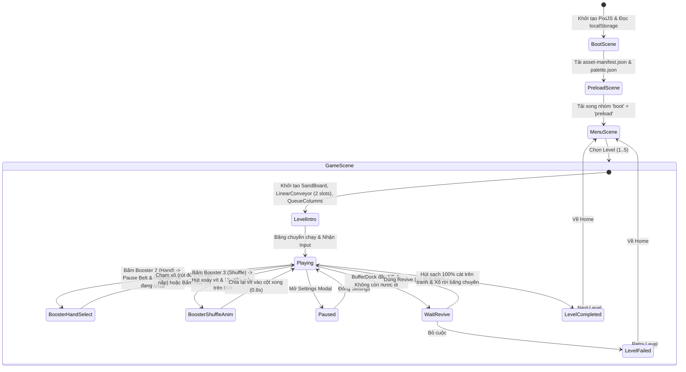

# 02. TECH STACK, KIẾN TRÚC HỆ THỐNG & CẤU TRÚC THƯ MỤC

> **Điều hướng nhanh:** [00_INDEX](./PLAN_SAND_CONVEYOR.md) | [01_MECHANICS](./01_GAME_DESIGN_MECHANICS.md) | **02_ARCHITECTURE** | [03_ASSETS](./03_ASSET_SPEC_INVENTORY.md) | [04_SCHEMA_CONFIG](./04_DATA_SCHEMA_CONFIG.md) | [05_LEVEL_DATA](./05_LEVEL_DATA_PACK.md) | [06_ROADMAP_QA](./06_ROADMAP_QA_RISKS.md)

---

## 1. Bảng Lựa chọn Công nghệ (Tech Stack)

| Hạng mục | Lựa chọn | Phiên bản | Lý do lựa chọn |
| :--- | :--- | :---: | :--- |
| **Renderer / Engine** | **PixiJS + GSAP** | `pixi.js@^8.6.0`<br>`gsap@^3.12.5` | PixiJS v8 tăng tốc phần cứng WebGL/WebGPU cho phép vẽ 3.000+ hạt cát tròn cùng lúc ở 60 FPS; GSAP xử lý cực mượt đường bay Bezier của vít, nắp xô bật mở và xoáy `Shuffle` (tương đương `DOTween` trong `SandLoopGame`). |
| **Ngôn ngữ** | **TypeScript** | `^5.7.2` | `strict: true`, kiểm soát chặt chẽ kiểu dữ liệu `colorId: number` và schema Level. |
| **Build Tool** | **Vite** | `^6.0.5` | Khởi động tức thì, hỗ trợ import JSON trực tiếp, đóng gói tĩnh gọn nhẹ (`base: './'`). |
| **Package Manager** | **pnpm** | `^9.15.0` | Tốc độ cài đặt nhanh, quản lý dependency chặt chẽ. |
| **Audio** | **Howler.js + Web Audio** | `howler@^2.2.4` | Phát SFX/BGM ổn định trên cả iOS Safari & Android Chrome + kết hợp Web Audio Synth cho tiếng hạt cát chảy liên hoàn. |
| **Lint & Format** | **ESLint + Prettier** | `eslint@^9.17.0`<br>`prettier@^3.4.2` | Chuẩn hóa code style toàn dự án. |
| **Unit & E2E Test** | **Vitest + Playwright** | `vitest@^2.1.8`<br>`@playwright/test@^1.49.1` | Vitest chạy unit test cho `src/game/` và bộ `validate-levels`; Playwright kiểm thử tự động trên trình duyệt thật. |
| **Hosting / Deploy** | **Cloudflare Pages / Vercel** | Static SPA | Tự động build & tạo link preview mỗi khi push code, đồng thời xuất gói zip tĩnh cho buổi thuyết trình Creative Day. |

---

## 2. Kiến trúc Phần mềm (Architecture)

### 2.1. Sơ đồ Luồng Scene & State Machine



### 2.2. Phân tách Trách nhiệm các Module Lõi

| Phân lớp | Module / File | Nhiệm vụ chính |
| :--- | :--- | :--- |
| **Core Infrastructure**<br>(`src/core/`) | `EventBus.ts` | Pub/Sub sự kiện có định kiểu giữa Logic (`src/game/`) và View (`src/view/`). |
| | `StateMachine.ts` | Quản lý trạng thái trận đấu (`PLAYING`, `BOOSTER_HAND_SELECT`, `BOOSTER_SHUFFLE_ANIM`, `WIN`, `LOSE`). |
| | `AssetLoader.ts` | Đọc `asset-manifest.json`, tải trước (`preload`) atlas/audio/font. |
| | `ColorManager.ts` | Đọc `palette.json`, ánh xạ `colorId: number` (int) sang mã màu Hex (`bodyHex`, `shadowHex`, `sandHex`). **Khi muốn đổi màu chỉ cần sửa `palette.json`.** |
| | `AudioManager.ts` | Quản lý phát SFX/BGM và tạo âm thanh cao độ biến thiên khi vặn 3 vít / hút cát. |
| | `InputManager.ts` | Phân biệt chạm nhanh (`tap < 125ms`) để bắn vít ở cột Queue và nhấn giữ (`hold >= 125ms`) để tăng tốc băng chuyền Linear `1.75x`. |
| | `SaveManager.ts` | Lưu tiến độ, số vàng, số lượng 3 Boosters vào `localStorage` kèm hàm `migrateSaveData()`. |
| **Pure Game Logic**<br>(`src/game/` — **Không phụ thuộc PixiJS/DOM**) | `SandBoardModel.ts` | Quản lý mảng 2D `grid: number[][]` (chứa `colorId: int`), tính cột rơi trọng lực và trả về hạt cát đáy khi xô hút. |
| | `LinearConveyorModel.ts` | Quản lý băng chuyền Linear, số slot mở (`activeSlots` khởi đầu bằng `defaultActiveSlots = 2`, mở tối đa `maxActiveSlots = 4`), tính toạ độ `x` của từng slot theo thời gian thực. |
| | `SandBucketModel.ts` | Quản lý 1 xô cát: `colorId: int`, mảng 3 lỗ vít `holes`, trạng thái nắp (`LOCKED` / `OPEN`), bộ đếm lượng cát đã hút `collected / capacity`. |
| | `BufferDockModel.ts` | Quản lý khay chờ 5 lỗ tạm; tự động chuyển vít lên xô khi có xô cùng `colorId` xuất hiện trên băng chuyền. |
| | `QueueColumnModel.ts` | Quản lý từng cột hàng đợi FIFO: lấy vít đỉnh `items[0]`, đôn hàng đợi dưới lên, giải mã vít ẩn `?` (`isMystery`). |
| | `BoosterRule.ts` | Chứa logic thuần của 3 Boosters: `useExtraSlot()`, `useHandOnBucket()`, `useShuffleWithPriority()`. |
| | `LevelValidator.ts` | Kiểm tra tính hợp lệ toán học của file JSON level và chạy Bot giải thử. |

---

## 3. Cấu trúc Thư mục ĐẦY ĐỦ

```text
CreativeDayT112026_SandConveyor/
├── index.html                              # Entry HTML, cấu hình viewport mobile portrait
├── package.json                            # Dependencies & scripts (dev, build, test, validate-levels)
├── tsconfig.json                           # Cấu hình TypeScript strict mode
├── vite.config.ts                          # Cấu hình Vite bundler
├── eslint.config.js                        # Cấu hình ESLint
├── .prettierrc                             # Cấu hình Prettier
├── .editorconfig
├── .gitignore
├── .gitattributes                          # Git LFS cho file nặng trong assets-src/
├── .env.example
├── README.md
├── CHANGELOG.md
│
├── _Docs/                                  # Bộ tài liệu thiết kế & kế hoạch đã tách nhỏ
│   ├── PLAN_SAND_CONVEYOR.md               # 00. Trang mục lục tổng quan (Master Index)
│   ├── 01_GAME_DESIGN_MECHANICS.md         # 01. Phân tích gameplay, băng chuyền 2-4 slot & 3 Boosters
│   ├── 02_TECH_ARCHITECTURE_FOLDER.md      # 02. Tech stack, kiến trúc & cây thư mục
│   ├── 03_ASSET_SPEC_INVENTORY.md          # 03. Chuẩn tài nguyên & bảng kiểm kê asset
│   ├── 04_DATA_SCHEMA_CONFIG.md            # 04. Schema TypeScript (colorId: int), balance & palette
│   ├── 05_LEVEL_DATA_PACK.md               # 05. Đặc tả & kiểm chứng toán học 5 Level mẫu
│   ├── 06_ROADMAP_QA_RISKS.md              # 06. Lộ trình Milestones, QA, rủi ro & việc làm ngay
│   ├── levels/                             # 5 file JSON level mẫu tách rời để verify trực tiếp
│   │   ├── level-001.json
│   │   ├── level-002.json
│   │   ├── level-003.json
│   │   ├── level-004.json
│   │   └── level-005.json
│   ├── image.png                           # Ảnh mockup gốc (Level 9 - Mèo Đen)
│   ├── Sand Screw (Copy).html              # Prototype HTML5 gốc
│   └── Sand Screw (Copy).md
│
├── public/                                 # Copy nguyên trạng khi build
│   ├── favicon.ico
│   ├── manifest.webmanifest
│   ├── icons/
│   └── assets/                             # Tài nguyên runtime
│       ├── asset-manifest.json
│       ├── images/
│       │   ├── atlases/                    # game-atlas.webp + game-atlas.json
│       │   ├── backgrounds/
│       │   └── ui/
│       ├── audio/
│       │   ├── bgm/
│       │   └── sfx/
│       ├── fonts/
│       │   └── fnt-fredoka-bold.woff2
│       └── data/
│           ├── palette.json                # Bảng định nghĩa colorId (int) -> mã màu Hex
│           └── levels/                     # Copy từ _Docs/levels/ sang khi chạy game
│               ├── level-001.json
│               ├── level-002.json
│               ├── level-003.json
│               ├── level-004.json
│               └── level-005.json
│
├── assets-src/                             # File gốc (PSD, PNG mask, WAV), không đóng gói khi ship
│   ├── art/
│   ├── audio/
│   └── fonts/
│
├── src/
│   ├── main.ts                             # Entry khởi tạo game
│   ├── config/
│   │   ├── game.config.ts                  # Kích thước khung 1080x1920, toạ độ các khu vực
│   │   ├── balance.json                    # defaultActiveSlots: 2, maxActiveSlots: 4, thông số 3 Boosters
│   │   └── constants.ts
│   ├── core/
│   │   ├── EventBus.ts
│   │   ├── StateMachine.ts
│   │   ├── AssetLoader.ts
│   │   ├── ColorManager.ts                 # Tra cứu colorId (int) -> màu hiển thị
│   │   ├── AudioManager.ts
│   │   ├── InputManager.ts
│   │   ├── SaveManager.ts
│   │   └── I18n.ts
│   ├── game/                               # Luật chơi thuần TS (dùng 100% colorId: number)
│   │   ├── models/
│   │   │   ├── SandBoardModel.ts
│   │   │   ├── LinearConveyorModel.ts
│   │   │   ├── SandBucketModel.ts
│   │   │   ├── BufferDockModel.ts
│   │   │   └── QueueColumnModel.ts
│   │   ├── rules/
│   │   │   ├── ScrewMatchRule.ts
│   │   │   ├── SandSuctionRule.ts
│   │   │   └── BoosterRule.ts
│   │   ├── level/
│   │   │   ├── LevelLoader.ts
│   │   │   └── LevelValidator.ts
│   │   └── GameState.ts
│   ├── scenes/
│   │   ├── BootScene.ts
│   │   ├── PreloadScene.ts
│   │   ├── MenuScene.ts
│   │   ├── GameScene.ts
│   │   └── ResultScene.ts
│   ├── view/
│   │   ├── entities/
│   │   │   ├── SandBoardView.ts
│   │   │   ├── LinearConveyorView.ts
│   │   │   ├── SandBucketView.ts
│   │   │   ├── BufferDockView.ts
│   │   │   ├── QueueColumnView.ts
│   │   │   └── ScrewView.ts
│   │   └── fx/
│   │       ├── SandStreamFX.ts
│   │       ├── ShuffleSpiralFX.ts
│   │       └── ConfettiFX.ts
│   ├── ui/
│   │   ├── components/
│   │   └── hud/
│   │       ├── TopHudView.ts
│   │       ├── BoosterBarView.ts
│   │       └── HandBoosterOverlay.ts
│   ├── services/
│   ├── i18n/
│   │   ├── vi.json
│   │   └── en.json
│   ├── styles/
│   │   └── main.css
│   ├── types/
│   │   └── level.types.ts
│   └── utils/
│
├── tools/
│   ├── image-to-level.ts                   # Chuyển ảnh PNG -> mảng 2D colorId (int)
│   ├── validate-levels.ts                  # Kiểm tra toàn vẹn toán học của mọi file level JSON
│   └── build-manifest.ts
│
├── tests/
│   ├── unit/
│   └── e2e/
│
└── .github/
    └── workflows/
        └── ci.yml
```

